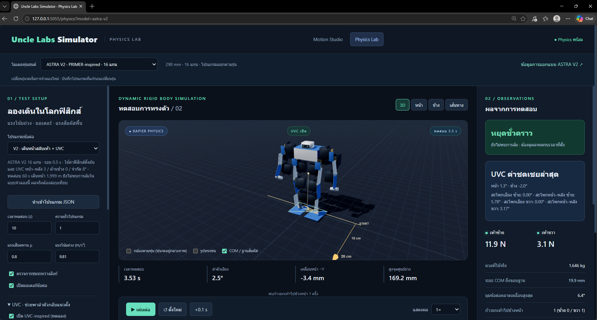

# Uncle Labs Simulator

เว็บจำลอง Mini Humanoid สำหรับออกแบบท่าการเคลื่อนไหวและทดสอบการเดินด้วยฟิสิกส์ พัฒนาด้วย **Flask + Three.js + Rapier** รองรับหุ่นยนต์ ASTRA V1 และ V2 ที่ใช้เซอร์โว DS3225MG

[GitHub Repository](https://github.com/UncleLabsBlacksmith/Mini-Humanoid-Simulator) · [ดาวน์โหลด ZIP](https://github.com/UncleLabsBlacksmith/Mini-Humanoid-Simulator/archive/refs/heads/main.zip)



## ความสามารถ

- **Motion Studio** — ปรับข้อต่อ สร้าง keyframes เล่นวนซ้ำ และนำเข้า/ส่งออก JSON
- **Physics Lab** — จำลองแรงโน้มถ่วง มอเตอร์ การชน และแรงสัมผัสพื้น โดยลำตัวเคลื่อนอิสระ
- เลือกโมเดล V1/V2 พร้อมรูปทรง ข้อต่อ มวล แบตเตอรี่ และคลังโปรแกรมแยกตามรุ่น
- ทดลองการทรงตัวด้วยตัวชดเชย **UVC-inspired**
- ดูจุดศูนย์มวล ฐานสัมผัส ระยะเดิน จำนวนก้าว มุมข้อต่อ และเหตุการณ์ล้ม
- ปรับแรงเสียดทาน มวล แรงบิด ความเร็วเซอร์โว และทดลองผลักหุ่น
- ส่งออกรายงาน JSON พร้อมค่าทดสอบและข้อมูลตามเวลา
- อ่านรายงานการออกแบบ V2 พร้อมแหล่งอ้างอิงและผลทดลอง

## โมเดลหุ่นยนต์

| รายการ | ASTRA V1 | ASTRA V2 |
| --- | --- | --- |
| รหัสโมเดล | `astra-v1` | `astra-v2` |
| ความสูงท่าตรง | 295 mm | 298 mm |
| ข้อต่อ / ลิงก์ | 12 / 13 | 16 / 17 |
| ข้อต่อขาต่อข้าง | 4 | 5 — เพิ่ม ankle roll |
| ข้อต่อแขนต่อข้าง | 2 | 3 — เพิ่ม shoulder roll |
| มวลรวมโดยประมาณ | 1.380 kg | 1.646 kg |
| แบตเตอรี่โดยประมาณ | 0.18 kg | 0.15 kg |
| ท่าเดินตั้งต้นใน Physics | `example-forward-steps` | `example-walk` |

**Uncle Labs Simulator** เป็นชื่อเว็บไซต์ ส่วน **ASTRA** เป็นชื่อโมเดลหุ่นยนต์ V2 ออกแบบโดยอ้างอิงแนวทาง PRIMER-V5 ของ Dr. Guero แล้วปรับให้เหมาะกับความสูงไม่เกิน 30 cm และ DS3225MG

## เริ่มใช้งาน

### สิ่งที่ต้องมี

- Python 3.10 ขึ้นไป พร้อม `pip`
- เบราว์เซอร์ที่รองรับ WebGL 2 และ WebAssembly
- Node.js สำหรับงานพัฒนาและชุดทดสอบเท่านั้น ไม่จำเป็นสำหรับเปิดเว็บ

ไฟล์ Three.js และ Rapier อยู่ใน `static/vendor/` แล้ว จึงไม่ต้องโหลดจาก CDN ขณะใช้งาน ส่วนการติดตั้ง dependency ครั้งแรกยังต้องเข้าถึงแหล่งแพ็กเกจ

### ดาวน์โหลดโปรเจกต์

หากติดตั้ง Git แล้ว ให้ดาวน์โหลด repository และเข้าโฟลเดอร์โปรเจกต์ด้วยคำสั่ง:

```bash
git clone https://github.com/UncleLabsBlacksmith/Mini-Humanoid-Simulator.git
cd Mini-Humanoid-Simulator
```

หากไม่ใช้ Git ให้ [ดาวน์โหลด ZIP](https://github.com/UncleLabsBlacksmith/Mini-Humanoid-Simulator/archive/refs/heads/main.zip) แล้วแตกไฟล์ จากนั้นเปิด Terminal ในโฟลเดอร์ที่มี `app.py` และ `requirements.txt`

เมื่อติดตั้งหรือดาวน์โหลดเสร็จ ให้ทำตามขั้นตอนของระบบปฏิบัติการด้านล่าง

### Windows / PowerShell

เปิด Terminal ในโฟลเดอร์ที่มี `app.py` แล้วรัน:

```powershell
python -m venv .venv
.\.venv\Scripts\python.exe -m pip install -r requirements.txt
.\.venv\Scripts\python.exe app.py --port 5055
```

คำสั่งนี้ใช้ Python ใน virtual environment โดยตรง ไม่ต้องเปลี่ยนนโยบายการรันสคริปต์ของ PowerShell

### macOS / Linux

```bash
python3 -m venv .venv
.venv/bin/python -m pip install -r requirements.txt
.venv/bin/python app.py --port 5055
```

| หน้า | ลิงก์ในเครื่อง |
| --- | --- |
| Motion Studio | [ออกแบบท่า](http://127.0.0.1:5055/) |
| Physics Lab | [ทดสอบฟิสิกส์](http://127.0.0.1:5055/physics) |
| Physics V2 | [เปิด V2 โดยตรง](http://127.0.0.1:5055/physics?model=astra-v2) |
| รายงานออกแบบ V2 | [แบบและงานวิจัย](http://127.0.0.1:5055/design/v2) |

`start.cmd` และ `start.ps1` เป็นทางลัด Windows ที่ใช้ `python` ใน PATH ต้องติดตั้ง Flask ให้ Python ตัวนั้นก่อน หรือใช้คำสั่ง virtual environment ด้านบน

เซิร์ฟเวอร์เริ่มที่ `127.0.0.1` สำหรับใช้งานในเครื่อง ยังไม่มีระบบบัญชีผู้ใช้หรือการตั้งค่าสำหรับให้บริการสาธารณะ **GitHub Pages ไม่สามารถรันส่วน Flask ของโปรเจกต์นี้ได้**

## วิธีใช้งาน

### Motion Studio

1. เลือกโมเดลและโปรแกรมตัวอย่าง หรือกด **ใหม่** เพื่อเริ่มจากท่ายืน
2. เลือก keyframe แล้วปรับมุมข้อต่อด้วย slider หรือช่องตัวเลข
3. กด **บันทึกท่านี้** หรือ **เพิ่มท่า** เพื่อเก็บมุมลงในลำดับ
4. กำหนดเวลา การเปลี่ยนระหว่างท่า และการวนซ้ำ แล้วกด **เล่น**
5. กด **บันทึกสำเนา** เพื่อเก็บในเครื่อง หรือ **ส่งออก JSON**

การปรับ slider ยังไม่แก้ keyframe จนกดบันทึกท่า ควรบันทึกโปรแกรมก่อนเปลี่ยนโมเดล เพราะการเปลี่ยนรุ่นจะโหลดการจำลองใหม่

### Physics Lab

1. เลือกโมเดลและท่าเดินของรุ่นนั้น หรือใช้ **นำเข้าโปรแกรม JSON**
2. เริ่มจากค่าตั้งต้น หรือกด **โหลดท่าเดินหน้าสลับเท้า + UVC**
3. ปรับเวลาทดสอบและค่าฟิสิกส์ แล้วกด **ใช้ค่าที่ตั้งและเริ่มใหม่**
4. กด **เริ่มทดสอบ** ดูระยะเดิน จำนวนก้าว มุมเอียง และผลการล้ม
5. ใช้ปุ่มผลักเพื่อทดลองแรงรบกวน หรือส่งออกรายงาน JSON

เส้น START และสเกลพื้นอยู่กับที่ หากเปิด **กล้องตามหุ่น** หุ่นจะอยู่กลางภาพแม้กำลังเคลื่อนที่ ให้ดูระยะและเส้นทางประกอบ หรือเลือกมุมมอง **เส้นทาง**

## โปรแกรม JSON

ใช้ไฟล์ตัวอย่างที่มีข้อต่อครบเป็นแม่แบบ:

- [ท่ายืน V1](data/programs/example-blank.json) / [ท่ายืน V2](data/programs/astra-v2/example-blank.json)
- [เดินหน้า V1](data/programs/example-forward-steps.json) / [เดินหน้า V2](data/programs/astra-v2/example-walk.json)

| ฟิลด์ | ความหมาย |
| --- | --- |
| `version` | เวอร์ชันข้อมูล ปัจจุบันคือ `1` |
| `modelId` | `astra-v1` หรือ `astra-v2` |
| `name`, `description` | ชื่อและคำอธิบาย |
| `loop` | เล่นวนซ้ำหรือไม่ |
| `interpolation` | `linear` หรือ `smooth` |
| `frames[].t` | เวลา หน่วยวินาที |
| `frames[].joints` | มุมองศาของทุกข้อต่อ |
| `frames[].root` | ตำแหน่ง `[x, y, z]` หน่วย mm สำหรับ Motion Studio |

โปรแกรมต้องมี 2–1,000 keyframes เริ่มที่เวลา 0 และเวลาเพิ่มขึ้นตามลำดับไม่เกิน 600 วินาที แต่ละท่าต้องมีข้อต่อครบ 12 แกนสำหรับ V1 หรือ 16 แกนสำหรับ V2 และมุมอยู่ในขอบเขตของรุ่นนั้น ระบบปฏิเสธไฟล์ต่างรุ่น ส่วน JSON เดิมของ V1 ที่ไม่มี `modelId` ยังใช้กับ V1 ได้

ระบบพิกัด: **+Z ขึ้น / −Y เดินหน้า / +X ขวา** มุมของแบบจำลองยังไม่ใช่คำสั่ง PWM

ไฟล์ที่บันทึกเองอยู่ใน `data/programs/user-*.json` สำหรับ V1 และ `data/programs/astra-v2/user-*.json` สำหรับ V2 ซึ่งถูกข้ามโดย `.gitignore` หากต้องการเผยแพร่ท่าที่ออกแบบเอง ให้เลือกตรวจแล้วจัดเก็บเป็นไฟล์ตัวอย่างต่างหาก

## ฟิสิกส์และผลทดสอบ

Motion Studio แสดงตำแหน่งและมุม ส่วน Physics Lab ใช้วัตถุแข็งอิสระ มอเตอร์ และแรงสัมผัสพื้น **Physics ไม่ใช้ `root` ใน JSON บังคับเลื่อนตัวหุ่น**

ค่าตั้งต้นร่วม: คำนวณ 240 Hz, แรงโน้มถ่วง 9.81 m/s², เสียดทาน 0.8, เพดานแรงบิด 1.2 N·m, ความเร็วไร้โหลด 300°/s, Kp/Kd = 6/0.08 และพักท่าแรก 1 s หน้าเว็บเปิด UVC gain หน้า–หลัง 3 s⁻¹ / ด้านข้าง 0 s⁻¹ / จำกัด ±8°

ตัวชดเชย UVC-inspired สะสมมุมเอียงเพื่อปรับสะโพกตามแรงรับน้ำหนักของแต่ละเท้า มีการจำกัดมุมและหยุดสะสมเมื่อเงื่อนไขไม่เหมาะสม เป็นการประยุกต์บางส่วนของแนวคิด ไม่ใช่การพอร์ต UVC ทั้งระบบ และ JSON ท่าเดินเพียงอย่างเดียวไม่มีตัวควบคุม feedback สำหรับหุ่นจริง

ตรวจว่า “ล้ม” เมื่อมีแรงสัมผัสพื้นมากกว่า 0.01 N ที่ลิงก์อื่นนอกจากเท้า หรือเอียงเกิน 50° ต่อเนื่องเกิน 0.15 s ตัวนับก้าวตรวจการยกพื้นเท้าอย่างน้อย 2 mm นาน 0.05 s แล้วลงรับแรงอย่างน้อย 0.5 N ในตำแหน่งหน้าเดิมเกิน 3 mm

ผลที่บันทึกไว้สำหรับท่าเดินตั้งต้นและค่าตามรายงาน รวมช่วงพักท่าแรก 1 s:

| โมเดล | เวลา | ระยะหน้า | ก้าวซ้าย / ขวา | เอียงสูงสุด | ผล |
| --- | ---: | ---: | ---: | ---: | --- |
| V1 | 60 s | 3.776 m | 115 / 113 | 12.84° | ไม่พบการล้ม |
| V2 | 60 s | 1.999 m | 111 / 112 | 14.64° | ไม่พบการล้ม |

ดู [รายงาน V1](data/forward-steps-validation.json) และ [รายงาน V2](data/v2-release-validation.json) ผลอาจมีการไถลหรือเบี่ยงทิศทาง ตัวนับก้าวไม่ได้ยืนยันว่าเท้าไม่ไถล

มวล แรงเสียดทาน และค่ามอเตอร์เป็นประมาณการ รูปทรงชนใช้กล่องและไม่ตรวจการชนของลิงก์ที่ต่อกันโดยตรง ยังไม่จำลองความยืดหยุ่น ระยะฟรีเกียร์ แรงดันตก ความร้อน หรือความคลาดเคลื่อนเซนเซอร์ ผล “ยังไม่ล้ม” ใช้ได้เฉพาะแบบจำลอง ค่าที่ใช้ และช่วงเวลาทดสอบ ไม่รับรองหุ่นจริง แบบ CAD ยังเป็นระดับแนวคิด และเว็บยังไม่มีการส่งคำสั่งไปยังเซอร์โวจริง

## โครงสร้างโปรเจกต์

```text
MiniHumanoid_Simulator/
├── app.py                     # Flask และ API
├── requirements.txt           # Python dependencies
├── package.json               # เครื่องมือและชุดทดสอบ JavaScript
├── package-lock.json          # ล็อกเวอร์ชัน dependency
├── templates/                 # หน้าเว็บและรายงาน V2
├── static/
│   ├── app.js                 # หน้าสร้างท่า
│   ├── physics.js             # หน้าทดสอบฟิสิกส์
│   ├── physics-core.mjs       # โลกฟิสิกส์และมอเตอร์
│   ├── uvc.mjs                # ตัวชดเชยสมดุล
│   ├── step-observer.mjs      # ตรวจการยกเท้าและก้าวหน้า
│   ├── robot.json             # ข้อต่อ V1
│   ├── meshes.json            # รูปทรง V1
│   ├── physics-model.json     # มวลและรูปทรงชน V1
│   ├── models/astra-v2/       # ข้อมูลโมเดล V2
│   ├── design-v2/             # ภาพและแบบฉาย
│   └── vendor/                # Three.js, Rapier และ license
├── data/
│   ├── programs/              # โปรแกรม V1
│   │   └── astra-v2/          # โปรแกรม V2
│   └── *validation.json       # ผลทดสอบ
├── tests/                     # ตรวจ API / motion / physics
├── prepare_v2.py              # สร้างข้อมูลเรขาคณิต V2
├── v2-gait.mjs                # สร้างท่า V2
├── v2-release.mjs             # ทดสอบท่าที่ส่งมอบ
├── build_v2_report.py         # สร้างรายงานและชุดไฟล์ V2
├── start.cmd / start.ps1      # ทางลัด Windows
└── .gitignore
```

### ชุด CAD ที่อยู่แยกจากเว็บ

ข้อมูลใน `static/` เพียงพอสำหรับเปิด Motion Studio และ Physics Lab โดยไม่ต้องติดตั้ง SolidCraft แต่ปุ่มดาวน์โหลดใน `/design/v2/files/...` อ่านไฟล์จากโฟลเดอร์ **ข้างเคียง** `MiniHumanoid_V2/` ซึ่งไม่รวมอยู่ในการอัปโหลดเฉพาะโฟลเดอร์เว็บ:

```text
workspace/
├── MiniHumanoid_Simulator/    # repository ของเว็บ (เปลี่ยนชื่อโฟลเดอร์นี้ได้)
└── MiniHumanoid_V2/           # แตกชุดออกแบบ V2 มาไว้ที่นี่
    ├── ASTRA_V2_298_Concept.solidcraft
    ├── ASTRA_V2_298_Concept.step
    ├── ASTRA_V2_Forward_Walk.json
    ├── ASTRA_V2_Design_Package.zip
    ├── BOM.csv
    └── physics-validation.json
```

หากเผยแพร่ CAD เป็นไฟล์แนบ GitHub Release ให้เก็บ ZIP ต้นฉบับและแตกเนื้อหาลงใน `MiniHumanoid_V2/` ตามโครงสร้างนี้ หากไม่มีชุดดังกล่าว หน้าอ่านรายงานยังเปิดได้ แต่ปุ่มดาวน์โหลด CAD จะใช้งานไม่ได้

เครื่องมือสร้างไฟล์ต้นฉบับมีข้อกำหนดเพิ่มเติม:

- `prepare_assets.py` ใช้ `robot.3mf` และ `../MiniHumanoid_DS3225/assembly_manifest.json` สำหรับ V1
- `prepare_v2.py` สร้างโมเดลและคำสั่ง CAD; การสร้าง SolidCraft/STEP ต้องใช้ SolidCraft CLI
- `verify_v2_cad.py` ต้องมีไฟล์ CAD และผลการสร้าง ตั้งพาธ CLI สำหรับ Windows ไว้ในสคริปต์
- `build_v2_report.py` ต้องมีผล validation ภาพ CAD และเอกสารใน `../MiniHumanoid_V2/`

ไม่ต้องรันเครื่องมือเหล่านี้เพื่อเปิดเว็บ การสร้างโมเดลหรือท่าใหม่จะเขียนทับไฟล์ที่สร้างได้ ควรบันทึกการแก้ไขก่อนใช้งาน

## สำหรับผู้พัฒนา

เวอร์ชันที่ใช้: Flask 3.1.3, Three.js 0.180.0 และ Rapier 0.21.0 เครื่องมือ Node.js ตรวจในสภาพแวดล้อม Node.js 24

```bash
npm ci
python -m unittest discover -s tests -v
npm test
```

ใช้ Python ที่ติดตั้ง `requirements.txt` แล้ว ชุด Python ตรวจดาวน์โหลด V2 ด้วย จึงต้องมี `../MiniHumanoid_V2/ASTRA_V2_Forward_Walk.json` จากชุดออกแบบ ส่วน `npm test` ใช้ข้อมูลใน repository

ตรวจท่าเดิน V2 ซ้ำ:

```bash
node v2-release.mjs
```

ค้นหาพารามิเตอร์และตรวจกรณีที่เลือกต่อเวลา:

```bash
node v2-search.mjs
node v2-validate.mjs verify
```

คำสั่งเหล่านี้เขียนผลลง `data/` รายงานที่อ้างอิงในเอกสารเก็บไว้ใน repository เพื่อใช้ตรวจสอบย้อนหลัง

### API หลัก

API ของโมเดล/โปรแกรมรับ `?model=astra-v1` หรือ `?model=astra-v2` ค่าเริ่มต้นคือ V1:

| Method | Path | หน้าที่ |
| --- | --- | --- |
| GET | `/api/health` | สถานะเซิร์ฟเวอร์ |
| GET | `/api/models` | รายการโมเดล |
| GET | `/api/robot` | ข้อต่อและลิงก์ของรุ่นที่เลือก |
| GET | `/api/programs` | รายการโปรแกรม |
| GET | `/api/programs/<id>` | อ่านโปรแกรม |
| POST | `/api/programs` | ตรวจและบันทึกสำเนาใหม่ |
| POST | `/api/validate` | ตรวจ JSON ชื่อข้อต่อ และช่วงมุม |

## แหล่งอ้างอิงและไลบรารี

- [Dr. Guero / Masahiko Yamaguchi](https://ai2001.ifdef.jp/)
- [PRIMER-V5](https://ai2001.ifdef.jp/primer_V5/primer_V5.html)
- [Upper Body Vertical Control](https://ai2001.ifdef.jp/uvc/uvc_Eng.html) และ [UVC Q&A](https://ai2001.ifdef.jp/uvc/QandA_Eng.html)
- [DS3225 datasheet](https://www.dsservo.com/d_file/DS3225%20datasheet.pdf)
- [Flask](https://flask.palletsprojects.com/)
- [Three.js](https://threejs.org/) — MIT; ดู [license ที่แนบ](static/vendor/LICENSE)
- [Rapier](https://rapier.rs/) — Apache-2.0; ดู [license ที่แนบ](static/vendor/RAPIER-LICENSE)

โค้ด UVC-inspired ในโครงการเขียนขึ้นใหม่จากแนวคิด ไม่ใช่โค้ดต้นฉบับทั้งระบบของ Dr. Guero

## License

โครงการเผยแพร่ภายใต้ [MIT License](LICENSE) — Copyright (c) 2026 Uncle Labs

ไลบรารีและทรัพยากรของบุคคลภายนอกยังใช้สัญญาอนุญาตของเจ้าของแต่ละรายการ ตามไฟล์และลิงก์อ้างอิงด้านบน
